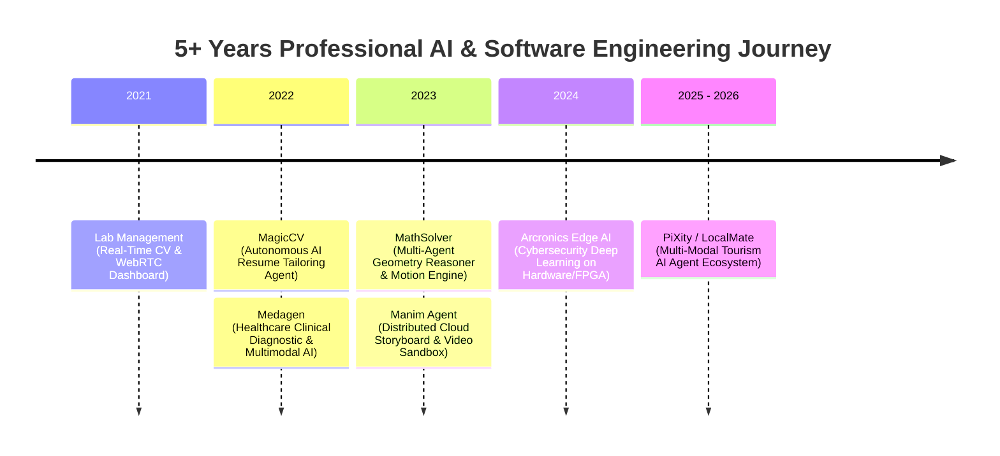

# Nguyen Xuan Cuong – Senior AI Engineer & Fullstack Architect

[](https://github.com/nxc1802)
[](https://www.linkedin.com/in/cuong-nguyen-2715a136b)
[](https://nxc-s-portfolio.vercel.app/)
[](mailto:nxcforwork@gmail.com)

---

## 📌 Professional Summary

Senior AI & Software Engineer with **5+ years** of hands-on experience in software development and AI engineering. Proven track record in researching, designing, and delivering production-grade Generative AI agents, Advanced RAG architectures, and real-time Computer Vision systems. Proven capability in bridging deep learning research with scalable full-stack and cloud deployments (AWS, GCP, Azure, Hugging Face, Vercel, Supabase, Nosana).

- **Generative AI & Autonomous Agent Orchestration**: 5+ years in AI/Software, 3+ years in LangChain, LangGraph, Mastra, Model Context Protocol (MCP), tool calling & multi-agent systems.
- **Advanced RAG & Knowledge Graphs**: Graph-RAG (Neo4j), hybrid vector search (Qdrant, Pinecone, Supabase pgvector), 768-dim semantic chunking & multi-LLM fallback orchestration.
- **Computer Vision & Edge Deep Learning**: YOLOv8/v10, MediaPipe, ByteTrack, Vision Transformers, CNNs, FPGA & firmware quantization/deployment.
- **High-Performance Distributed Backends**: FastAPI, Python (Expert), Node.js, Celery worker sandboxes, Redis AOF, WebSockets, WebRTC.
- **Technical Leadership & Delivery**: Experienced with technical proposals, effort estimations, agile processes, and AI-accelerated engineering (Cursor, Copilot). Fluent in English (IELTS 6.5 equivalent).

---

## 📁 Repository Structure

```text
Personal_Resume/
├── BSOL_Senior-AI-Engineer_Nguyen-Xuan-Cuong.docx   # Master CV in B-Solutions / FPT Enterprise Word Template
├── Nguyen_Xuan_Cuong_Senior_AI_Engineer_Resume.pdf  # Publication-grade PDF compiled via LaTeX
├── CV.tex                                           # Clean, modular LaTeX source code
├── template_BSOL_Senior-FS-.Net-ReactJS-Azure...docx # Original reference template downloaded from Google Docs
├── generate_cv.py                                   # Automated Python generator to rebuild the Word CV
└── README.md                                        # Profile overview & repository documentation
```

---

## 🛠️ Technical Skills & Competencies

| Domain | Key Technologies & Frameworks | Proficiency | Exp. |
| :--- | :--- | :---: | :---: |
| **Programming Languages** | Python, C++ | 4 - Applied theory | 5+ yrs |
| **Languages & DBs** | Java, JavaScript / TypeScript, SQL | 3 - Practical application | 3+ / 4+ yrs |
| **Machine Learning (ML)** | Classical ML algorithms, feature engineering, Scikit-learn | 5 - Recognized authority | 3+ yrs |
| **Deep Learning (DL)** | Neural network architectures, PyTorch, TensorFlow | 5 - Recognized authority | 3+ yrs |
| **Computer Vision (CV)** | YOLOv8/v10, MediaPipe, ByteTrack, DeepSORT, Vision Transformers (ViT) | 5 - Recognized authority | 3+ yrs |
| **NLP** | Text preprocessing, tokenization, semantic embeddings & classification | 3 - Practical application | 3+ yrs |
| **Generative AI & Agents** | LangChain, LangGraph, Mastra, Model Context Protocol (MCP), ReAct Agents | 4 - Applied theory | 3+ yrs |
| **Vector DBs & RAG** | Graph-RAG (Neo4j), Qdrant, Pinecone, Supabase pgvector, 768-dim Embeddings | 4 - Applied theory | 3+ yrs |
| **Backend & Distributed** | FastAPI (Python), Redis (AOF), Celery, WebSockets, WebRTC, PostgreSQL | 4 - Applied theory | 3+ / 4+ yrs |
| **Backend (Node.js)** | Node.js, Express, async APIs | 3 - Practical application | 3+ yrs |
| **Frontend (ReactJS)** | ReactJS, Next.js, SPA, SSR & interactive dashboards | 3 - Practical application | 3+ yrs |
| **DevOps & Cloud** | Docker, Docker Compose, AWS, GCP, Azure, Hugging Face Spaces, Nosana | 3 - Practical application | 3+ yrs |
| **Foreign Languages** | English (IELTS 6.5 Equivalent - Professional working), Vietnamese (Native) | 4 - Applied theory | 5+ yrs |

---

## 💼 Chronological Experience (5+ Years Timeline)



### 1. PiXity / LocalMate – Multi-Modal Tourism AI Agent Ecosystem
- **Duration**: `03/2025 – Present` | **Role**: Senior AI Developer / AI Architect | **Team**: 4 members
- **Tech Stack**: Python, TypeScript, Node.js, FastAPI, Gemini API, OpenRouter, Graph-RAG, Neo4j, Pinecone, Redis, Docker
- **Highlights**:
  - Architected end-to-end multi-agent AI system combining Graph-RAG (Neo4j) and Pinecone vector search for spatial-temporal itinerary planning.
  - Implemented multi-turn conversational agents with autonomous tool calling; won **2nd Runner-up at GDG DevFest MienTrung 2025**.

### 2. Arcronics Edge AI & Cybersecurity Defense System
- **Duration**: `06/2024 – 02/2025` | **Role**: Senior AI Engineer / Embedded AI Specialist | **Team**: 5 members
- **Tech Stack**: Python, C/C++, PyTorch, Scikit-learn, SQLite, PostgreSQL, Embedded Linux, FPGA Toolchains
- **Highlights**:
  - Trained deep learning architectures for malware classification and zero-day attack detection.
  - Quantized, pruned, and integrated neural models directly into microchips and FPGA hardware.

### 3. Manim Agent – Distributed Educational AI Storyboard & Video Platform
- **Duration**: `10/2023 – 05/2024` | **Role**: Lead AI & Fullstack Architect | **Team**: 2 members
- **Tech Stack**: Python, TypeScript, FastAPI, Celery, Redis (AOF), React SPA, Supabase, Hugging Face Protected Spaces, Cairo/Pango
- **Highlights**:
  - Engineered an end-to-end multi-service AI pipeline converting educational prompts into structured storyboards and Manim animation scripts.
  - Built an isolated Celery worker execution sandbox deployed to Hugging Face Docker Spaces with WebSocket state synchronization.

### 4. MathSolver – Multi-Agent Geometry Problem Solver & Motion Renderer
- **Duration**: `02/2023 – 09/2023` | **Role**: Senior AI Engineer | **Team**: 3 members
- **Tech Stack**: Python, TypeScript, FastAPI, Next.js, OCR Engine, Manim Engine, Supabase PostgreSQL, OpenRouter
- **Highlights**:
  - Built OCR parsing models extracting geometric shapes and equations into formal step-by-step reasoning steps.
  - Designed automated code generation pipeline compiling math proofs into interactive 2D/3D motion graphics.

### 5. Medagen – AI Patient Triage & Diagnostic Assistant
- **Duration**: `07/2022 – 01/2023` | **Role**: Fullstack AI Developer | **Team**: 6 members
- **Tech Stack**: Python, TypeScript, LangChain ReAct, Gemini API, Vision Transformers (ViT), CNNs, Supabase pgvector, Qdrant
- **Highlights**:
  - Architected clinical diagnostic assistant using LangChain ReAct agent workflows for multi-turn symptom triage and medical tool invocation.
  - Integrated Vision Transformers for dermatological lesion classification with hybrid vector retrieval over medical literature.

### 6. MagicCV – Autonomous Resume Tailoring AI Agent
- **Duration**: `01/2022 – 06/2022` | **Role**: AI Engineer | **Team**: 2 members
- **Tech Stack**: Python, TypeScript, Mastra Agent Framework, Gemini LLM, Supabase pgvector, pdflatex, Nosana GPU Network
- **Highlights**:
  - Automated candidate extraction from GitHub, LinkedIn, and YouTube APIs with 768-dim vector ranking.
  - Finalist at **Nosana Builders Challenge: Agents 102 (4th Place)**.

### 7. Lab Management – Real-Time AI Computer Vision Dashboard
- **Duration**: `05/2021 – 12/2021` | **Role**: Computer Vision & Software Engineer | **Team**: 5 members
- **Tech Stack**: Python, TypeScript, C++, YOLOv8, ByteTrack, Janus WebRTC, WebSockets, PostgreSQL, Next.js
- **Highlights**:
  - Deployed real-time YOLO object detection and ByteTrack tracking pipelines achieving 30+ FPS stream telemetry over WebSockets.

---

## 🏆 Honors, Awards & Competitions

- **2nd Runner-up**: Hackathon GDG DevFest MienTrung 2025
- **Second Prize**: AI4SE 2025 Competition
- **4th Place**: Hackathon Nosana Builders Challenge: Agents 102 (2025)
- **Superteam Honorable Mention**: Timelocked Wallet (2025)
- **Finalist**: AI4LIFE 2024, Research Connection 2025, Research Festival 2025, Grab The Beyond 2026
- **Recipient of 100% Full-Tuition Scholarship**: FPT University (Merit-based)

---

## 📚 Publications & Research

1. **MAFIS**: Multi-Agent Imitation by learning and sampling from FactorIzed Soft Q-function.
2. **Identification of Plant Leaf Diseases**: Using CNN and SVM for precision agriculture.
3. **The GYM Exercise Classification Dataset**: 2D/3D pose analysis using CNN-LSTM and MediaPipe.
4. **Towards Sparse Adversarial Perturbations**: Gradient-Guided Approach for Efficient Image Attacks.

---

## 📞 Contact Information

- **Name**: Nguyen Xuan Cuong (Nguyễn Xuân Cường)
- **Location**: Da Nang, Vietnam
- **Email**: [nxcforwork@gmail.com](mailto:nxcforwork@gmail.com)
- **Phone**: +84 327 755 183
- **GitHub**: [github.com/nxc1802](https://github.com/nxc1802)
- **LinkedIn**: [linkedin.com/in/cuong-nguyen-2715a136b](https://www.linkedin.com/in/cuong-nguyen-2715a136b)
- **Portfolio**: [nxc-s-portfolio.vercel.app](https://nxc-s-portfolio.vercel.app)
